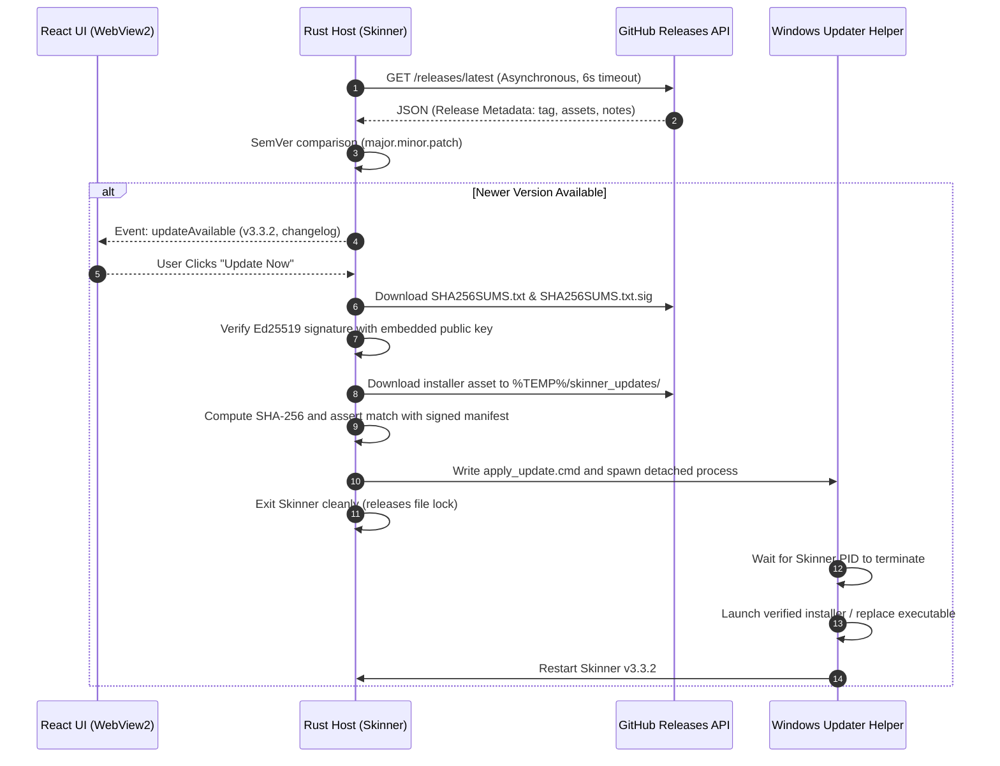

# Skinner Auto-Update System — Architecture & Release Guide

**Version:** 3.3.2  
**Target Repository:** `dahakabdellah12/Skinner`  
**Security Standard:** Ed25519 Signed Manifests + Mandatory SHA-256 + Confined URL Whitelist  

---

## 1. Architectural Overview



The auto-update system in Skinner v3.3.2 is an end-to-end native update pipeline designed to eliminate manual downloads, prevent Remote Code Execution (RCE), survive network disruptions, and handle Windows file locking (`ERROR_SHARING_VIOLATION`) reliably.

---

## 2. Threat Model & Security Architecture

### 2.1 Threat Analysis & Mitigations

| Threat Vector | Attack Scenario | Skinner v3.3.2 Mitigation |
| :--- | :--- | :--- |
| **Tampered Release Binary** | Attacker intercepts download or compromises release asset CDN. | Downloaded installer SHA-256 is verified against `SHA256SUMS.txt` cryptographically signed with the official Ed25519 private key. Mismatches abort immediately and purge temporary files. |
| **Multi-Tenant CDN Spoofing** | Attacker uploads malicious `.exe` to their own GitHub repo and feeds the `objects.githubusercontent.com` CDN link. | Whitelist strictly enforces `https://github.com/dahakabdellah12/Skinner/releases/download/`. Multi-tenant CDN URLs are rejected outright. |
| **Path Traversal in Version** | Attacker crafts a tag like `../../cmd.exe` to write outside the temporary directory. | `sanitize_version_string` filters non-alphanumeric/dot/dash characters and blocks leading dots and `..` traversal patterns. |
| **WebView Origin Hijacking** | A rogue link navigates the WebView to a third-party site while retaining IPC bridge. | Wry's `with_navigation_handler` strictly blocks any navigation outside `brawlcraft://`. |
| **Compromised Release Notes** | Attacker alters release body markdown containing checksums. | Checksums are extracted strictly from the digitally signed `SHA256SUMS.txt` file, never from unauthenticated markdown prose. |
| **Failing Open on Errors** | Network drop or missing signature allows unverified binary to run. | Verification fails closed: missing signatures, malformed keys, or hash mismatches immediately terminate the process without spawning anything. |

### 2.2 Cryptographic Key Specifications

- **Algorithm:** Ed25519 (RFC 8032 Edwards-curve Digital Signature)
- **Key Length:** 256-bit (32 bytes) public key, 512-bit (64 bytes) signature
- **Embedded Public Key (Hex):**
  ```text
  105b8cf237a941fd069f8281a7b3e4e5361b3eddeff10e8626da224054e90f5a
  ```
- **Embedded Public Key (Rust Array):**
  ```rust
  pub const OFFICIAL_PUBLIC_KEY_BYTES: [u8; 32] = [
      0x10, 0x5b, 0x8c, 0xf2, 0x37, 0xa9, 0x41, 0xfd,
      0x06, 0x9f, 0x82, 0x81, 0xa7, 0xb3, 0xe4, 0xe5,
      0x36, 0x1b, 0x3e, 0xdd, 0xef, 0xf1, 0x0e, 0x86,
      0x26, 0xda, 0x22, 0x40, 0x54, 0xe9, 0x0f, 0x5a,
  ];
  ```

---

## 3. Windows Update Installation & File-Lock Handoff

Windows NT kernel prevents overwriting or modifying an executable file while it is currently mapped in memory by a running process (`ERROR_SHARING_VIOLATION` / 0x20).

To solve this safely without requiring administrator privileges:
1. The update is downloaded and verified in `%TEMP%/skinner_updates/Skinner-Setup-3.3.2.exe`.
2. Skinner generates `%TEMP%/skinner_updates/apply_update.cmd`:
   ```cmd
   @echo off
   setlocal
   set PID=<skinner_pid>
   set INSTALLER=<path_to_verified_installer>

   :wait_pid
   timeout /t 1 /nobreak >NUL
   tasklist /FI "PID eq %PID%" 2>NUL | findstr /I "%PID%" >NUL
   if not errorlevel 1 goto wait_pid

   start "" "%INSTALLER%"
   exit
   ```
3. Skinner spawns the script as an independent detached process with `CREATE_NO_WINDOW` (`0x08000000`).
4. Skinner exits cleanly with code 0.
5. The helper script confirms the PID is dead, executes the installer, and the new version launches.
6. All user settings, presets, and pristine game backups reside in `%LOCALAPPDATA%/Skinner` and the game directory, and are preserved completely.

---

## 4. Packaging & Publishing Workflow for Releases

### 4.1 Release Assets Required
Each GitHub release for Skinner MUST contain:
1. `Skinner-3.3.2-windows-x64.zip` (Portable binary distribution)
2. `Skinner-Setup-3.3.2.exe` (Windows Installer, if compiled with Inno Setup)
3. `SHA256SUMS.txt` (Plain text list of SHA-256 hashes and filenames)
4. `SHA256SUMS.txt.sig` (Ed25519 signature file generated by the private release key)

### 4.2 Step-by-Step Signing & Packaging Instructions

1. **Build Production Assets:**
   ```powershell
   npm run build
   cargo build --release
   ```
2. **Update Publish Directory:**
   ```powershell
   Copy-Item target\release\Skinner.exe publish\Skinner.exe -Force
   Compress-Archive -Path publish\* -DestinationPath release\Skinner-3.3.2-windows-x64.zip -Force
   ```
3. **Generate Hashes:**
   ```powershell
   $hash = (Get-FileHash release\Skinner-3.3.2-windows-x64.zip -Algorithm SHA256).Hash.ToLower()
   "$hash  Skinner-3.3.2-windows-x64.zip" | Out-File -Encoding ascii release\SHA256SUMS.txt
   ```
4. **Sign the Checksums File:**
   Run the automated signature generation test:
   ```powershell
   cargo test --test updater_tests test_generate_and_verify_v332_release_signature
   ```
   This generates `release/SHA256SUMS.txt.sig` and verifies it against the embedded public key.
5. **Publish to GitHub Releases:**
   - Create a new release with tag `v3.3.2`.
   - Title: `Skinner v3.3.2 — Cryptographic Auto-Updater & Security Hardening`
   - Upload:
     - `release/Skinner-3.3.2-windows-x64.zip`
     - `release/SHA256SUMS.txt`
     - `release/SHA256SUMS.txt.sig`
   - Publish the release.

---

## 5. Verification & Testing

The updater test suite in [`tests/updater_tests.rs`](file:///c:/Users/Dahak%20Abdellah/Downloads/Project/brawlcraft-slint/tests/updater_tests.rs) runs automatically via `cargo test --test updater_tests`.

Key tests executed:
- `test_semver_parsing_and_comparison`: Verifies numeric ordering (`3.3.10` > `3.3.9`, `3.3.2` > `3.3.1`).
- `test_ed25519_signature_verification_and_tampering`: Validates authentic signature verification and verifies that single-bit payload or signature corruptions are rejected.
- `test_sha256sums_parsing`: Verifies multi-file checksum manifest parsing.
- `test_trusted_release_url_validation`: Rejects non-GitHub URLs, multi-tenant CDN domains, and traversal sequences.
- `test_version_sanitization`: Enforces strict character allowlist on version strings.
- `test_sha256_file_computation_and_tampering`: Verifies streaming SHA-256 file calculations against known vectors.
- `test_prerelease_and_draft_filtering_logic`: Verifies that prereleases and drafts are ignored by automatic updates.
- `test_generate_and_verify_v332_release_signature`: Verifies the real v3.3.2 release signature matches the embedded public key.
